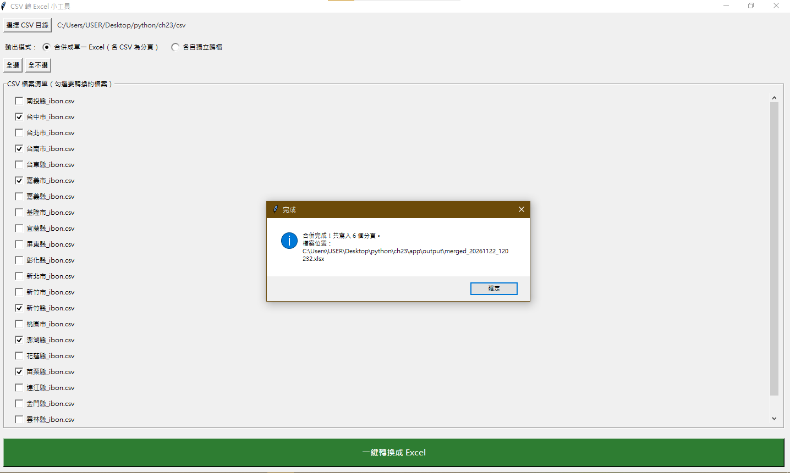

# CSV 轉 Excel 批次小工具 (CSV to Excel Batch Tool)

這是一支使用 Python 開發的輕量級本機桌面小工具，專為解決日常資料整理痛點而設計。支援指定目錄掃描 CSV 檔案、勾選批次轉換、多檔合併分頁，並自動修正中文亂碼、保留前導零與最佳化欄位寬度。

## 🖼️ 介面預覽



## ✨ 核心特色

* **直覺視窗操作**：使用 Python 內建 `tkinter` 打造，支援選擇資料夾、檔案清單捲動、全選 / 全不選以及一鍵轉換。

* **雙輸出模式支援**：

  * **合併模式（預設）**：將勾選的多個 CSV 檔案合併至同一個 `.xlsx` 檔案中（自動加上時間戳記命名，避免覆蓋舊檔），每個 CSV 各自獨立為一個工作表（Sheet）。

  * **獨立模式**：將勾選的每個 CSV 檔案各自轉換為同名的獨立 `.xlsx` 檔案。

* **智慧分頁命名防呆**：合併模式下會自動過濾 Excel 工作表名稱不允許的特殊字元（`\ / ? * : [ ]`）、截斷超過 31 字元的名稱，並為重複名稱自動加上編號。

* **中文編碼自動偵測**：依序嘗試以 `utf-8-sig`、`utf-8`、`cp950`（繁體中文 Big5 擴充）讀取檔案，徹底解決開啟 CSV 常見的亂碼問題。

* **完整保留前導零**：讀取時強制將所有欄位視為純文字（`dtype=str`），確保門市店號（如 `001234`）、電話號碼或郵遞區號開頭的 `0` 不會被 Excel 自動消除。

* **自動適配欄位寬度**：寫入 Excel 後自動計算各欄內容長度（中文字元寬度計為 `2`、英數符號計為 `1`）並保留適當邊距，開啟報表無需手動拉寬欄位。

* **純函式架構**：全程式採用純函式（Function-based）設計，無複雜類別封裝，程式碼結構清晰、易於閱讀與二次維護。

## 🛠️ 環境需求與安裝

### 1. Python 版本

建議使用 **Python 3.8** 或以上版本。

### 2. 安裝相依套件

`tkinter` 為 Python 標準內建函式庫，僅需透過 `pip` 安裝 `pandas` 與 `openpyxl`：

```bash
pip install pandas openpyxl
```

## 🚀 使用方式

1. **啟動程式**
   在終端機（Terminal / CMD）中執行主程式：

   ```bash
   python csv_to_excel_tool.py
   ```

2. **選擇 CSV 目錄**
   點擊視窗左上方的 **「選擇 CSV 目錄」** 按鈕，挑選存放 `.csv` 檔案的資料夾。

3. **勾選目標檔案**
   清單會自動列出該目錄下所有的 CSV 檔案（預設全選），可依需求個別勾選或使用 **「全選」/「全不選」** 快速調整。

4. **選擇輸出模式**

   * **合併成單一 Excel（各 CSV 為分頁）** *(預設)*

   * **各自獨立轉檔**

5. **執行轉換**
   點擊下方綠色的 **「一鍵轉換成 Excel」** 按鈕，完成後程式會彈出提示視窗並顯示輸出路徑。

## 📂 目錄結構說明

執行轉換後，程式會自動在**執行檔（或 `.py` 腳本）所在的同層目錄**下建立 `output` 資料夾統一存放結果：

```text
專案目錄/
├── csv_to_excel_tool.py      # 主程式
├── README.md                 # 專案說明文件
├── screenshot/               # 畫面截圖資料夾
│   └── pic_01.png            # 工具操作介面截圖
└── output/                   # 自動建立的輸出資料夾
    ├── merged_20261122_114500.xlsx   # 合併模式輸出範例
    └── 門市資料.xlsx                   # 獨立模式輸出範例
```

## 📦 進階：打包成 Windows 獨立執行檔（.exe）

若希望在未安裝 Python 環境的電腦上雙擊直接執行，可使用 `PyInstaller` 進行打包：

```bash
pip install pyinstaller
pyinstaller --onefile --windowed --name "CSV轉Excel小工具" csv_to_excel_tool.py
```

打包完成後，可於 `dist/` 資料夾內取得 `CSV轉Excel小工具.exe`。執行該 `.exe` 時，同樣會在執行檔旁邊自動建立 `output` 資料夾存放轉檔結果。